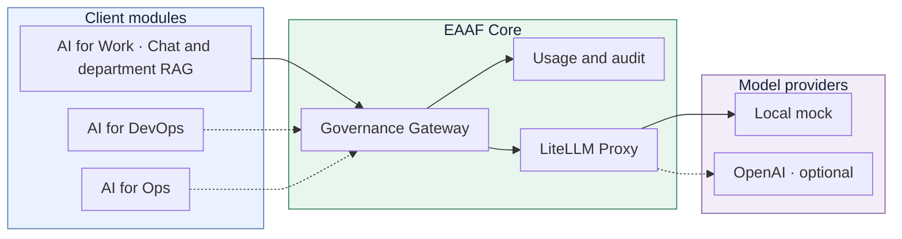

# EAAF · Enterprise Agentic AI Framework

EAAF is an open-source framework for building enterprise AI applications around a shared governance layer. The goal is to give Chat, retrieval-augmented generation (RAG), and agents a common way to access models under application-specific policies.

The current version is a self-contained local demo. It includes the Governance Gateway, model selection and routing, and a bundled browser Chat demo. The standalone Work application runs the local RAG pilot. It runs against a simulated provider with Docker Compose. OpenAI is optional. The browser application can also run independently from the [EAAF Work repository](https://github.com/tandrian06/eaaf-work).

## Repositories

| Repository | What it contains |
| --- | --- |
| [EAAF Core](https://github.com/tandrian06/eaaf) | Governance Gateway, application authentication, usage controls, and LiteLLM routing. It also governs model calls for architecture intake. |
| [EAAF Work](https://github.com/tandrian06/eaaf-work) | Chat portal and department RAG. It calls Core for authentication, generation, and optional embeddings. |
| [EAAF DevOps](https://github.com/tandrian06/eaaf-devops) | Architecture intake, validation, and the reusable CLI that generates Terraform module calls and input files. |
| [EAAF Ops](https://github.com/tandrian06/eaaf-ops) | Read-only ECS incident diagnosis from saved captures or live AWS events. Core can provide an optional explanation. |
| [EAAF Deployment Demo](https://github.com/tandrian06/eaaf-deployment-demo) | A working example that takes reviewed YAML and a prepared Terraform module through generation, PR review, and an optional AWS Fargate deployment. |

## Architecture



The Governance Gateway handles application identity, policies, and usage limits. Solid arrows show the standard request path and Core's internal dependencies. Dashed arrows show optional calls. Work can run independently on port 8001 and uses Core on port 8000. Work owns document retrieval. Before searching, it asks Core to authenticate the application key and authorize the department and generation model. DevOps can generate Terraform from reviewed YAML locally, and Ops can diagnose ECS events locally. Both call Core only when requesting model assistance.

## Run the local demo

With Python 3.12 and Docker Compose v2, run from the repository root.

```sh
python scripts/init_local_env.py
docker compose up --build --wait
```

The setup script generates unique keys in the Git-ignored `.env` file. If local keys already exist, it adds the Global key when missing and preserves existing values. Compose requires the keys at startup.

| Chat space | Local URL | Key name in `.env` |
| --- | --- | --- |
| Global | [`/chat/global`](http://127.0.0.1:8000/chat/global) | `EAAF_GLOBAL_API_KEY` |
| HR | [`/chat/hr`](http://127.0.0.1:8000/chat/hr) | `EAAF_HR_API_KEY` |
| IT | [`/chat/it`](http://127.0.0.1:8000/chat/it) | `EAAF_IT_API_KEY` |
| Marketing | [`/chat/marketing`](http://127.0.0.1:8000/chat/marketing) | `EAAF_MARKETING_API_KEY` |

The root URL opens the EAAF portal with Global Chat and links to the department apps. Each department has a link back to the portal. Navigation switches spaces without carrying over the key or conversation. The Gateway rejects a valid key from a different space before model routing.

1. Open [HR App](http://127.0.0.1:8000/chat/hr) and paste the value of `EAAF_HR_API_KEY` from `.env` into **Application key**.
2. Send a message with the preselected `eaaf-mock-hr`. The provider replies with `Hello from the EAAF HR mock (eaaf-mock-hr). This response is simulated.`
3. Open **IT**, enter its key, and send a message. The default `eaaf-mock-it` identifies itself as the IT mock. Global and Marketing likewise identify their own mocks.
4. To see a policy denial, paste the HR key into the IT App and send a message. The Gateway returns **HTTP 403** and keeps the draft.

Send a follow-up with the same key to include the previous turns, or select **New chat** to clear them. The browser keeps the key and conversation in page memory and sends them to the local Gateway. The demo binds to loopback and uses synthetic data and local demo credentials. Initial image and dependency downloads require registry access.

### Try department knowledge

Run [EAAF Work](https://github.com/tandrian06/eaaf-work) alongside Core and open the Work portal on port 8001. Work holds the corpus and retrieves the excerpts. Core authenticates the application key, checks the department and model, and applies quotas, simulated budgets, and audit to generation and optional embedding calls.

### Application policies

| Application | Allowed models | Requests per UTC day | Simulated monthly budget |
| --- | --- | ---: | ---: |
| Global | `eaaf-mock`, `eaaf-openai-mini` (optional) | 50 | $3.00 |
| HR | `eaaf-mock-hr`, `eaaf-openai-mini` (optional) | 20 | $1.00 |
| IT | `eaaf-mock-it`, `eaaf-openai-mini` (optional) | 100 | $10.00 |
| Marketing | `eaaf-mock-marketing`, `eaaf-openai-mini` (optional) | 50 | $2.00 |

[Application profiles](config/applications.yaml) reference the Chat keys by environment variable. The Gateway and LiteLLM share `LITELLM_MASTER_KEY` for their internal connection. `EAAF_MOCK_API_KEY` supplies the value expected by the OpenAI-compatible adapter for the local mock. Recreate the affected services after changing keys.

To call the API directly, use [Swagger UI](http://127.0.0.1:8000/docs). Choose **Authorize**, enter the Global key from `.env`, and call `POST /v1/chat/completions`.

```json
{
  "model": "eaaf-mock",
  "messages": [{"role": "user", "content": "Hello"}]
}
```

The Gateway returns **401** for missing or invalid credentials, **403** for a forbidden model, and **429** for an exhausted quota or budget. Use [`/healthz`](http://127.0.0.1:8000/healthz) to check service availability.

### Optional OpenAI mode

Add `OPENAI_API_KEY` to the local, Git-ignored `.env` and start with both Compose files.

```sh
docker compose -f compose.yaml -f compose.openai.yaml up --build --wait
```

Open [IT App](http://127.0.0.1:8000/chat/it), paste the IT application key, and select `eaaf-openai-mini (external, billed)`. LiteLLM routes the alias to OpenAI's `gpt-4.1-mini`. Global, HR, IT, and Marketing authorize it when OpenAI mode is enabled. Each space still selects its own mock by default. Use synthetic input for the demo. OpenAI receives the messages and bills the project. The EAAF usage report still uses the simulated per-call cost.

The overlay gives only LiteLLM an external network and the provider key. Run `docker compose up --build --wait` with the base configuration to return to mock-only mode. For a future remote deployment, store `OPENAI_API_KEY` as an environment-scoped GitHub Actions secret.

### Usage and audit

Each admitted dispatch reserves one request and a simulated $0.02 before LiteLLM is called. Upstream failures still count. Denied requests cost zero. Daily and monthly windows use UTC.

```sh
docker compose exec -T gateway python -m eaaf.usage
```

The JSON report groups decisions, simulated cost, and reported tokens by UTC month and application. SQLite persists in a named Docker volume. The audit stores metadata and excludes prompts, replies, keys, and unrecognized model strings.

## Repository layout

```text
chat/       Bundled browser Chat client for the original local demo
eaaf/       FastAPI Gateway and local usage store
config/     Application policies and LiteLLM model routing
docs/       Architecture and design notes
tests/      Gateway and end-to-end tests
```

Docker Compose launches the demo as one stack. Chat uses the Gateway's HTTP API, and LiteLLM already runs as a separate service. The standalone Work application can be run independently from its own repository. Replicated Gateways would need shared, transactional quota and budget state plus a shared audit store.

### Credentials for remote deployment

Store remote application keys and the LiteLLM master key as GitHub Actions secrets scoped to the target deployment environment. A future deployment workflow will pass them to the corresponding services as runtime environment variables. Real provider keys belong in that same secret store and are passed only to the service that calls the provider. The local mock key is used only when deploying the mock stack. Keep the Chat assets independent of these secrets.

## Delivery history

Each sprint delivered a testable outcome in small increments. The local mock made it possible to verify each stage without cloud credentials.

| Sprint | Delivered and verified |
| --- | --- |
| 1 · Gateway MVP | Routed a model request through Core and LiteLLM to the local mock, then added application authentication, model policies, quotas, simulated budgets, and metadata-only audit. |
| 2 · Chat demo | Added a browser client to exercise model selection, conversation history, and policy denials across application identities. The standalone Chat portal now lives in EAAF Work. |
| 3 · Department RAG | Added retrieval and source display for isolated department corpora. EAAF Work now owns the documents and search, while Core governs model calls. |

The agent pilot remains a future cloud automation increment.

## Tests

With Python 3.12 in a virtual environment:

```sh
python -m pip install -r requirements-dev.txt
python -m pytest -q
```

To include end-to-end tests, start the Compose stack and run the suite with `EAAF_E2E_URL=http://127.0.0.1:8000`. In PowerShell:

```powershell
$env:EAAF_E2E_URL = 'http://127.0.0.1:8000'
python -m pytest -q
Remove-Item Env:EAAF_E2E_URL
docker compose down
```

GitHub Actions generates temporary keys for each CI run, builds the Compose stack, and runs the same suite. CI uses the simulated provider.

See [Architecture](docs/architecture.md) for implementation details. EAAF code is licensed under the [MIT License](LICENSE). Third-party components are distributed under their own terms.
