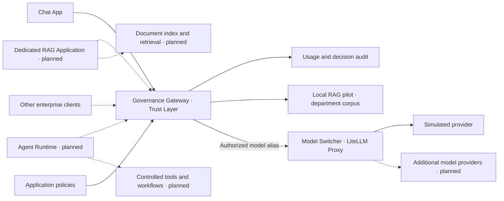

# EAAF · Enterprise Agentic AI Framework

EAAF is an open-source framework for building enterprise AI applications around a shared governance layer. The goal is to give Chat, retrieval-augmented generation (RAG), and agents a common way to access models under application-specific policies.

The current version is a self-contained local demo. It includes the Governance Gateway, model selection and routing, a browser Chat app, and a local RAG pilot. It runs against a simulated provider with Docker Compose. OpenAI is optional.

## Target architecture



Solid lines show the components wired together in the local demo. Dashed lines show the intended extensions. The Gateway controls which application may call which model and under what limits. The Model Switcher resolves the authorized alias to a provider. RAG retrieval and agent tool execution belong to their respective components, with their own access controls.

## Components and sprint roadmap

| Component | Role | Delivery |
| --- | --- | --- |
| **Governance Gateway** | FastAPI trust layer for application authentication, model allowlists, daily quotas, simulated monthly budgets, and audit metadata. | **Sprint 1 · available** |
| **Model Switcher** | LiteLLM Proxy routes each space's mock alias to the local simulator. An optional configuration adds OpenAI for all four spaces. | **Sprint 1 · alias routing available.** The Chat demo adds per-space mocks and optional OpenAI. |
| **Chat App** | Browser client for selecting a model, keeping conversation turns in memory, and showing responses or policy denials. | **Sprint 2 · available** |
| **RAG** | Retrieve excerpts from the authenticated department's fictional corpus and send them with the question through the Gateway. | **Sprint 3 · first increment available** |
| **Agent Runtime** | Run workflows that call models through the Gateway and enforce separate controls on tool execution and approvals. | **Sprint 4 · proposed** |

Sprint 4 describes the intended next step. The current API supports non-streaming text chat completions and the scoped Chat endpoints support optional knowledge retrieval.

## How we build and validate EAAF

The **MVP** answers one question. Can an enterprise application make a governed model call and see why the Gateway allowed or refused it? A request, its policy decision, and the corresponding usage record are enough to exercise that flow. The simulated provider keeps the result reproducible and removes the need for cloud credentials during validation.

A **sprint** has a demonstrable outcome. An **increment** is a smaller change within a sprint that can be run and tested with the existing stack.

| Sprint | Increments | What we verify |
| --- | --- | --- |
| **1 · Gateway MVP** | Route a request through the Gateway and LiteLLM to the mock. Add application keys and model allowlists. Then add quotas, simulated budgets, and audit. | Verify the full request path first. Then check that denials stop before routing, limits hold under concurrent calls, and the audit excludes message content. |
| **2 · Chat demo** | Add a browser client over the existing HTTP API. Add conversation history, model selection, and visible policy errors. | Use the same model with two application keys and observe different outcomes. Verify that changing keys clears the conversation. |
| **3 · RAG pilot** | Search a small local document set by department and attach the matching excerpts before generation. Display the sources beside the reply. | Verify document isolation, behavior without a matching source, and that generation still passes through the Gateway. |
| **4 · Agent pilot, proposed** | Start with a bounded workflow and a single controlled tool. | Check who can invoke the tool, how approval is enforced, and what is recorded. |

Each delivered increment is exercised locally with Compose, then checked in GitHub Actions before merge. A simulated provider and synthetic inputs let us verify routing, policy, and failure behavior before connecting real providers or data. The local stack also gives reviewers a reproducible way to try the same scenario. For a larger deployment, the HTTP boundaries let us package and scale each component separately when its workload calls for it.

## Run the local demo

With Python 3.12 and Docker Compose v2, run from the repository root.

```sh
python scripts/init_local_env.py
docker compose up --build --wait
```

The setup script generates unique keys in the Git-ignored `.env` file. If local keys already exist, it adds the Global key when missing and preserves existing values. Compose requires the keys at startup.

| Chat space | Local URL | Key name in `.env` |
| --- | --- | --- |
| Global | [`/chat/global`](http://127.0.0.1:8000/chat/global) | `EAAF_GLOBAL_API_KEY` |
| HR | [`/chat/hr`](http://127.0.0.1:8000/chat/hr) | `EAAF_HR_API_KEY` |
| IT | [`/chat/it`](http://127.0.0.1:8000/chat/it) | `EAAF_IT_API_KEY` |
| Marketing | [`/chat/marketing`](http://127.0.0.1:8000/chat/marketing) | `EAAF_MARKETING_API_KEY` |

The root URL opens the EAAF portal with Global Chat and links to the department apps. Each department has a link back to the portal. Navigation switches spaces without carrying over the key or conversation. The Gateway rejects a valid key from a different space before model routing.

1. Open [HR App](http://127.0.0.1:8000/chat/hr) and paste the value of `EAAF_HR_API_KEY` from `.env` into **Application key**.
2. Send a message with the preselected `eaaf-mock-hr`. The provider replies with `Hello from the EAAF HR mock (eaaf-mock-hr). This response is simulated.`
3. Open **IT**, enter its key, and send a message. The default `eaaf-mock-it` identifies itself as the IT mock. Global and Marketing likewise identify their own mocks.
4. To see a policy denial, paste the HR key into the IT App and send a message. The Gateway returns **HTTP 403** and keeps the draft.

Send a follow-up with the same key to include the previous turns, or select **New chat** to clear them. The browser keeps the key and conversation in page memory and sends them to the local Gateway. The demo binds to loopback and uses synthetic data and local demo credentials. Initial image and dependency downloads require registry access.

### Try department knowledge

In a department App, enter its application key, enable **Use department knowledge**, and send a question. Try **Comment poser des congés ?** in HR, **Comment configurer le VPN ?** in IT, or **Où trouver le logo ?** in Marketing. Open **Sources** under the reply to read the selected excerpts. Global has no department corpus.

The [fictional knowledge corpus](config/knowledge.yaml) is searched locally with accent-insensitive keywords. Each request uses up to two excerpts from its department. An unmatched question shows an error and skips the provider call. With a mock model, the reply identifies the simulator and the sources show what was retrieved. With optional OpenAI, the model receives the selected excerpts and is instructed to ground its reply in them. Use the fictional corpus and synthetic questions with external providers.

### Application policies

| Application | Allowed models | Requests per UTC day | Simulated monthly budget |
| --- | --- | ---: | ---: |
| Global | `eaaf-mock`, `eaaf-openai-mini` (optional) | 50 | $3.00 |
| HR | `eaaf-mock-hr`, `eaaf-openai-mini` (optional) | 20 | $1.00 |
| IT | `eaaf-mock-it`, `eaaf-openai-mini` (optional) | 100 | $10.00 |
| Marketing | `eaaf-mock-marketing`, `eaaf-openai-mini` (optional) | 50 | $2.00 |

[Application profiles](config/applications.yaml) reference the Chat keys by environment variable. The Gateway and LiteLLM share `LITELLM_MASTER_KEY` for their internal connection. `EAAF_MOCK_API_KEY` supplies the value expected by the OpenAI-compatible adapter for the local mock. Recreate the affected services after changing keys.

To call the API directly, use [Swagger UI](http://127.0.0.1:8000/docs). Choose **Authorize**, enter the Global key from `.env`, and call `POST /v1/chat/completions`.

```json
{
  "model": "eaaf-mock",
  "messages": [{"role": "user", "content": "Hello"}]
}
```

The Gateway returns **401** for missing or invalid credentials, **403** for a forbidden model, and **429** for an exhausted quota or budget. Use [`/healthz`](http://127.0.0.1:8000/healthz) to check service availability.

### Optional OpenAI mode

Add `OPENAI_API_KEY` to the local, Git-ignored `.env` and start with both Compose files.

```sh
docker compose -f compose.yaml -f compose.openai.yaml up --build --wait
```

Open [IT App](http://127.0.0.1:8000/chat/it), paste the IT application key, and select `eaaf-openai-mini (external, billed)`. LiteLLM routes the alias to OpenAI's `gpt-4.1-mini`. Global, HR, IT, and Marketing authorize it when OpenAI mode is enabled. Each space still selects its own mock by default. Use synthetic input for the demo. OpenAI receives the messages and bills the project. The EAAF usage report still uses the simulated per-call cost.

The overlay gives only LiteLLM an external network and the provider key. Run `docker compose up --build --wait` with the base configuration to return to mock-only mode. For a future remote deployment, store `OPENAI_API_KEY` as an environment-scoped GitHub Actions secret.

### Usage and audit

Each admitted dispatch reserves one request and a simulated $0.02 before LiteLLM is called. Upstream failures still count. Denied requests cost zero. Daily and monthly windows use UTC.

```sh
docker compose exec -T gateway python -m eaaf.usage
```

The JSON report groups decisions, simulated cost, and reported tokens by UTC month and application. SQLite persists in a named Docker volume. The audit stores metadata and excludes prompts, replies, keys, and unrecognized model strings.

## Repository layout

```text
chat/       Browser Chat client
eaaf/       FastAPI Gateway and local usage store
config/     Application policies and LiteLLM model routing
docs/       Architecture and design notes
tests/      Gateway and end-to-end tests
```

Docker Compose launches the demo as one stack. Chat uses the Gateway's HTTP API, and LiteLLM already runs as a separate service. A scaled deployment can package those components independently from this repository. Replicated Gateways would need shared, transactional quota and budget state plus a shared audit store.

### Credentials for remote deployment

Store remote application keys and the LiteLLM master key as GitHub Actions secrets scoped to the target deployment environment. A future deployment workflow will pass them to the corresponding services as runtime environment variables. Real provider keys belong in that same secret store and are passed only to the service that calls the provider. The local mock key is used only when deploying the mock stack. Keep the Chat assets independent of these secrets.

## Tests

With Python 3.12 in a virtual environment:

```sh
python -m pip install -r requirements-dev.txt
python -m pytest -q
```

To include end-to-end tests, start the Compose stack and run the suite with `EAAF_E2E_URL=http://127.0.0.1:8000`. In PowerShell:

```powershell
$env:EAAF_E2E_URL = 'http://127.0.0.1:8000'
python -m pytest -q
Remove-Item Env:EAAF_E2E_URL
docker compose down
```

GitHub Actions generates temporary keys for each CI run, builds the Compose stack, and runs the same suite. CI uses the simulated provider.

See [Architecture](docs/architecture.md) for implementation details. EAAF code is licensed under the [MIT License](LICENSE). Third-party components are distributed under their own terms.
