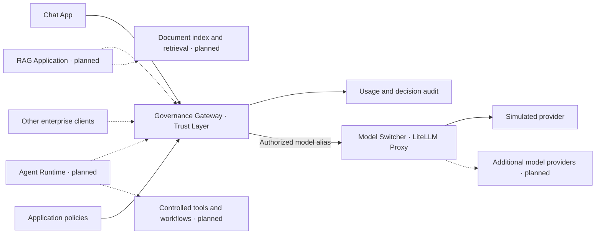

# EAAF · Enterprise Agentic AI Framework

EAAF is an open-source framework for building enterprise AI applications around a shared governance layer. The goal is to give Chat, retrieval-augmented generation (RAG), and agents a common way to access models under application-specific policies.

The current version is a self-contained local demo. It includes the Governance Gateway, model selection and routing, and a browser Chat app. It runs against a simulated provider with Docker Compose.

## Target architecture



Solid lines show the components wired together in the local demo. Dashed lines show the intended extensions. The Gateway controls which application may call which model and under what limits. The Model Switcher resolves the authorized alias to a provider. RAG retrieval and agent tool execution belong to their respective components, with their own access controls.

## Components and sprint roadmap

| Component | Role | Delivery |
| --- | --- | --- |
| **Governance Gateway** | FastAPI trust layer for application authentication, model allowlists, daily quotas, simulated monthly budgets, and audit metadata. | **Sprint 1 · available** |
| **Model Switcher** | LiteLLM Proxy resolves a requested model alias to a provider. The demo routes two aliases to one mock provider. | **Sprint 1 · alias routing available.** Additional providers and routing policies are future work. |
| **Chat App** | Browser client for selecting a model, keeping conversation turns in memory, and showing responses or policy denials. | **Sprint 2 · available** |
| **RAG** | Retrieve authorized excerpts from indexed documents and send the grounded generation request through the Gateway. | **Sprint 3 · proposed** |
| **Agent Runtime** | Run workflows that call models through the Gateway and enforce separate controls on tool execution and approvals. | **Sprint 4 · proposed** |

Sprint 3 and Sprint 4 describe the intended sequence. The current API supports non-streaming text chat completions.

## How we build and validate EAAF

The **MVP** answers one question. Can an enterprise application make a governed model call and see why the Gateway allowed or refused it? A request, its policy decision, and the corresponding usage record are enough to exercise that flow. The simulated provider keeps the result reproducible and removes the need for cloud credentials during validation.

A **sprint** has a demonstrable outcome. An **increment** is a smaller change within a sprint that can be run and tested with the existing stack.

| Sprint | Increments | What we verify |
| --- | --- | --- |
| **1 · Gateway MVP** | Route a request through the Gateway and LiteLLM to the mock. Add application keys and model allowlists. Then add quotas, simulated budgets, and audit. | Verify the full request path first. Then check that denials stop before routing, limits hold under concurrent calls, and the audit excludes message content. |
| **2 · Chat demo** | Add a browser client over the existing HTTP API. Add conversation history, model selection, and visible policy errors. | Use the same model with two application keys and observe different outcomes. Verify that changing keys clears the conversation. |
| **3 · RAG pilot, proposed** | Start with a small local document set and add retrieval before generation. | Check that the answer uses permitted excerpts and that the model call still passes through the Gateway. |
| **4 · Agent pilot, proposed** | Start with a bounded workflow and a single controlled tool. | Check who can invoke the tool, how approval is enforced, and what is recorded. |

Each delivered increment is exercised locally with Compose, then checked in GitHub Actions before merge. A simulated provider and synthetic inputs let us verify routing, policy, and failure behavior before connecting real providers or data. The local stack also gives reviewers a reproducible way to try the same scenario. For a larger deployment, the HTTP boundaries let us package and scale each component separately when its workload calls for it.

## Run the local demo

With Docker Compose v2, run from the repository root.

```sh
docker compose up --build --wait
```

1. Open [EAAF Chat](http://127.0.0.1:8000/) and select **HR** to load its demo key.
2. Select `eaaf-mock` and send a message. The simulated provider replies with `Hello from the EAAF mock provider.`
3. Keep the HR key, switch to `eaaf-mock-extended`, and send a message. The Gateway returns **HTTP 403** and the Chat app keeps your draft.
4. Select **IT** and send a new message with the same extended model. The Gateway allows the request. Changing application keys clears the conversation.

Send a follow-up with the same key to include the previous turns, or select **New chat** to clear them. The browser keeps the key and conversation in page memory and sends them to the local Gateway. The demo binds to loopback and uses synthetic data and local demo credentials. Initial image and dependency downloads require registry access.

### Application policies

| Application | Allowed models | Requests per UTC day | Simulated monthly budget |
| --- | --- | ---: | ---: |
| HR | `eaaf-mock` | 20 | $1.00 |
| IT | `eaaf-mock`, `eaaf-mock-extended` | 100 | $10.00 |
| Marketing | `eaaf-mock-extended` | 50 | $2.00 |

[Application profiles](config/applications.yaml) reference keys by environment variable. Override the Compose defaults with `EAAF_HR_API_KEY`, `EAAF_IT_API_KEY`, and `EAAF_MARKETING_API_KEY`, then recreate the Gateway. If you override a key, enter it manually in Chat.

To call the API directly, use [Swagger UI](http://127.0.0.1:8000/docs). Choose **Authorize**, enter the local demo token (for example, `eaaf-local-hr`), and call `POST /v1/chat/completions`.

```json
{
  "model": "eaaf-mock",
  "messages": [{"role": "user", "content": "Hello"}]
}
```

The Gateway returns **401** for missing or invalid credentials, **403** for a forbidden model, and **429** for an exhausted quota or budget. Use [`/healthz`](http://127.0.0.1:8000/healthz) to check service availability.

### Usage and audit

Each admitted dispatch reserves one request and a simulated $0.02 before LiteLLM is called. Upstream failures still count. Denied requests cost zero. Daily and monthly windows use UTC.

```sh
docker compose exec -T gateway python -m eaaf.usage
```

The JSON report groups decisions, simulated cost, and reported tokens by UTC month and application. SQLite persists in a named Docker volume. The audit stores metadata and excludes prompts, replies, keys, and unrecognized model strings.

## Repository layout

```text
chat/       Browser Chat client
eaaf/       FastAPI Gateway and local usage store
config/     Application policies and LiteLLM model routing
docs/       Architecture and design notes
tests/      Gateway and end-to-end tests
```

Docker Compose launches the demo as one stack. Chat uses the Gateway's HTTP API, and LiteLLM already runs as a separate service. A scaled deployment can package those components independently from this repository. Replicated Gateways would need shared, transactional quota and budget state plus a shared audit store.

## Tests

With Python 3.12 in a virtual environment:

```sh
python -m pip install -r requirements-dev.txt
python -m pytest -q
```

To include end-to-end tests, start the Compose stack and run the suite with `EAAF_E2E_URL=http://127.0.0.1:8000`. In PowerShell:

```powershell
$env:EAAF_E2E_URL = 'http://127.0.0.1:8000'
python -m pytest -q
Remove-Item Env:EAAF_E2E_URL
docker compose down
```

GitHub Actions builds the Compose stack and runs the same suite.

See [Architecture](docs/architecture.md) for implementation details. EAAF code is licensed under the [MIT License](LICENSE). Third-party components are distributed under their own terms.
