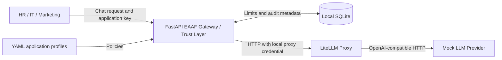

# EAAF Gateway Architecture

## Sprint 1 request path

- **EAAF Gateway** loads the HR, IT, and Marketing profiles from `config/applications.yaml` at startup. It authenticates the application key and checks the requested alias against that application's allowlist before routing. It forwards only supported request fields and uses its own proxy credential. It returns 502 for upstream failures and 504 for timeouts.
- **LiteLLM Proxy** routes the four space-specific mock aliases to one local provider using `config/litellm.yaml`. The optional OpenAI overlay adds a real model for Global, HR, IT, and Marketing. The Gateway and Proxy share a master key supplied through their runtime environment. Local keys are generated in the Git-ignored `.env` file.
- **Mock LLM Provider** generates a unique completion ID, fixed simulated token counts, and a reply that names its space and model alias. It does not need any model weights or external services.

Compose exposes only the gateway on `127.0.0.1:8000`. LiteLLM and the mock are reachable on an internal Compose network. The gateway health endpoint reports process availability. The end-to-end test verifies all three services together.

## Usage and audit

After authentication and model authorization, the gateway checks the daily quota and monthly budget together in a SQLite write transaction. It records the reservation before contacting the proxy, so concurrent requests cannot overspend the simulated budget. Admitted requests consume quota and fixed simulated cost even after an upstream failure. A reservation with no recorded outcome remains visible as `admitted`. This budget models local usage in integer cents.

SQLite stores timestamps, application identifiers, domain, cost center, permitted model aliases, decisions, status codes, simulated cost, and reported token totals when available. Authentication failures carry no application identity. Model denials omit the raw requested alias. Request bodies, response bodies, and credentials are excluded. Framework request-validation errors are outside the decision audit. A storage failure returns HTTP 503. If it occurs before dispatch, LiteLLM is never called.

## Sprint 2 Chat client

The Chat client lives in the top-level `chat/` directory beside the `eaaf/` gateway package. One frontend serves Global, HR, IT, and Marketing spaces. Chat submits to `POST /chat/{space}/completions`, which checks that the authenticated application matches the space and then runs the same completion handler as `POST /v1/chat/completions`. Global has its own key, allowlist, and limits. The key and accepted conversation turns are held in page memory and cleared when leaving the space. All authorization, quotas, budget checks, and audit decisions remain in the gateway.

RAG and agent clients can share the same gateway boundary. Each new capability can extend the client contract and governance policies independently of the provider deployment.
