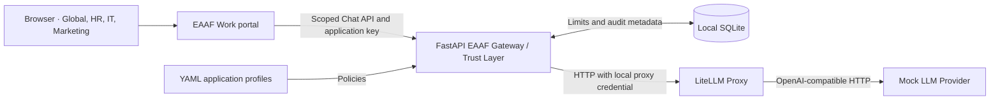

# EAAF Gateway Architecture

## Sprint 1 request path

- **EAAF Gateway** loads the HR, IT, and Marketing profiles from `config/applications.yaml` at startup. It authenticates the application key and checks the requested alias against that application's allowlist before routing. It forwards only supported request fields and uses its own proxy credential. It returns 502 for upstream failures and 504 for timeouts.
- **LiteLLM Proxy** routes the four space-specific mock aliases to one local provider using `config/litellm.yaml`. The optional OpenAI overlay adds a real model for Global, HR, IT, and Marketing. The Gateway and Proxy share a master key supplied through their runtime environment. Local keys are generated in the Git-ignored `.env` file.
- **Mock LLM Provider** generates a unique completion ID, fixed simulated token counts, and a reply that names its space and model alias. It does not need any model weights or external services.

Compose exposes only the gateway on `127.0.0.1:8000`. LiteLLM and the mock are reachable on an internal Compose network. The gateway health endpoint reports process availability. The end-to-end test verifies all three services together.

## Usage and audit

After authentication and model authorization, the gateway checks the daily quota and monthly budget together in a SQLite write transaction. It records the reservation before contacting the proxy, so concurrent requests cannot overspend the simulated budget. Admitted requests consume quota and fixed simulated cost even after an upstream failure. A reservation with no recorded outcome remains visible as `admitted`. This budget models local usage in integer cents.

SQLite stores timestamps, application identifiers, domain, cost center, permitted model aliases, decisions, status codes, simulated cost, and reported token totals when available. Authentication failures carry no application identity. Model denials omit the raw requested alias. Request bodies, response bodies, and credentials are excluded. Framework request-validation errors are outside the decision audit. A storage failure returns HTTP 503. If it occurs before dispatch, LiteLLM is never called.

## Sprint 2 Chat client

The standalone Chat client lives in [EAAF Work](https://github.com/tandrian06/eaaf-work). Work serves the browser assets and forwards scoped Chat requests to Core. Core still bundles a copy in `chat/` for the original local Compose demo. Work forwards the application key and Core verifies it. The current department retrieval stays in Core. One frontend serves Global, HR, IT, and Marketing spaces. Chat submits to `POST /chat/{space}/completions`, which checks that the authenticated application matches the space and then runs the same completion handler as `POST /v1/chat/completions`. Global has its own key, allowlist, and limits. The key and accepted conversation turns are held in page memory and cleared when leaving the space. All authorization, quotas, budget checks, and audit decisions remain in the gateway.

## Sprint 3 department knowledge

The local RAG pilot loads fictional Markdown documents from `knowledge/` using the `config/knowledge.yaml` manifest. At startup the Gateway checks source IDs, file sizes, and paths. Each file must resolve inside its department directory. The Chat UI requests knowledge explicitly. After application authentication, space authorization, and model authorization, the Gateway selects the corpus using the authenticated application identity. It retrieves up to two keyword matches for the latest question and adds only those excerpts to the model context. Source IDs, titles, and excerpts are returned with the completion. Requests without a match stop before provider dispatch. The audit keeps decisions and usage metadata.

The mock demonstrates retrieval and source display with a fixed response. An enabled external model can use the excerpts to generate a grounded response. External calls include the selected excerpts. The pilot uses lexical search over trusted synthetic documents. A future retrieval service can share the same gateway boundary.

Optional semantic retrieval uses the LiteLLM embeddings endpoint and an in-memory index keyed by authenticated department. The first search embeds the question and that department's sources in one batch. Subsequent requests reuse document vectors and embed only the latest question. The Gateway reserves quota and simulated budget before embedding, filters candidates to the authorized corpus, and applies cosine similarity and a minimum score before dispatching generation. The audit stores neither embeddings nor document or question text.

## AI for DevOps integration

[AI for DevOps](https://github.com/tandrian06/eaaf-devops) is the AWS-first Architecture-to-Terraform module. It owns the versioned architecture schema, ECS Fargate pattern validation, and review output. A structured YAML manifest can be reviewed entirely within the DevOps CLI.

For natural-language intake, the CLI calls `POST /v1/chat/completions` with a dedicated application key. The DevOps repository supplies an optional Compose overlay that registers the DevOps application policy and its architecture model alias. The Gateway authenticates the request, enforces the allowlist and usage limits, and records audit metadata. LiteLLM routes the authorized request to OpenAI. The CLI validates the resulting draft and reports open decisions and pattern conflicts.

The DevOps CLI can inspect a prepared Terraform module and generate a module call and input file from reviewed YAML. The [deployment demo](https://github.com/tandrian06/eaaf-deployment-demo) exercises that path locally and through GitHub Actions. Its AWS workflow supports a reviewed plan and a manually triggered apply.
